# AURA 2.0 — Native Android Meditation, Music Library & Voice Companion

A production-oriented, offline-first native Android wellness application combining guided meditation, personal music library management, procedural ambient soundscapes with multi-layer mixing, private voice journaling with real-time waveform visualization, automatic on-device transcription with timestamp jumping, distraction blocking, and a persistent floating assistant inspired by Gemini's overlay interaction model.

---

## 1. Product Architecture Diagram

```mermaid
graph TD
    subgraph UI Layer ["Presentation (Jetpack Compose & Material 3)"]
        NavHost["AuraNavHost & Navigation Compose"]
        HomeScreen["Home Sanctuary Dashboard"]
        LibraryScreen["Music Library & Playlists"]
        PlaylistScreen["Playlist Detail & Track Reordering"]
        PlayerScreen["Enhanced Now Playing & Ambient Mixer"]
        VoiceJournalScreen["Voice Journal (Record/Pause/Waveform)"]
        VoiceLibraryScreen["Voice Library (Folders & Timeline)"]
        JournalDetail["Reflection Detail & Timestamps"]
        MeditationScreen["Guided Meditation"]
        BreathingScreen["Paced Breathing (Box/4-7-8)"]
        FocusScreen["Focus Timer & Intention"]
        AppBlockerScreen["App Restrictor Selector"]
        SettingsScreen["Settings & Privacy"]
    end

    subgraph Service Layer ["Android OS System Services"]
        MediaService["AuraMediaService (MediaSessionService)"]
        OverlayService["FloatingAssistantService (TYPE_APPLICATION_OVERLAY)"]
        AccessibilityBlocker["AppBlockerAccessibilityService"]
        ReminderReceiver["AuraReminderReceiver (Alarm/Notification)"]
    end

    subgraph Core Engine ["Core Logic & Managers"]
        PlaybackManager["AudioPlaybackManager (Queue/Shuffle/Repeat/Fade)"]
        ImportManager["AudioImportManager (SAF & MediaMetadataRetriever)"]
        AmbientMixer["AmbientSoundscapeMixer (5 Concurrent Layers)"]
        VoiceRecorder["VoiceRecorder (MediaRecorder + Waveform)"]
        TranscriptionEngine["AndroidSpeechTranscriptionEngine"]
        JournalIntel["JournalIntelligence (Deterministic Summarizer)"]
        AudioGen["ProceduralAudioGenerator (8 Offline WAV Synthesizers)"]
    end

    subgraph Data Layer ["Offline Persistence"]
        RoomDB[("Aura Room Database v2\n(Tracks, Playlists, Folders, Notes, Rules)")]
        DataStore[("DataStore Preferences\n(Theme, Routine, Active Focus)")]
        InternalStorage["App-Private Storage (filesDir/imported_music, filesDir/voice_notes)"]
    end

    NavHost --> HomeScreen
    NavHost --> LibraryScreen
    NavHost --> PlaylistScreen
    NavHost --> PlayerScreen
    NavHost --> VoiceJournalScreen
    NavHost --> VoiceLibraryScreen
    NavHost --> JournalDetail
    NavHost --> MeditationScreen
    NavHost --> BreathingScreen
    NavHost --> FocusScreen
    NavHost --> AppBlockerScreen
    NavHost --> SettingsScreen

    LibraryScreen --> ImportManager
    PlayerScreen --> PlaybackManager
    PlayerScreen --> AmbientMixer
    VoiceJournalScreen --> VoiceRecorder
    JournalDetail --> TranscriptionEngine
    JournalDetail --> JournalIntel
    PlaybackManager --> MediaService
    PlaybackManager --> RoomDB
    ImportManager --> RoomDB
    VoiceRecorder --> InternalStorage
```



---

## 2. AURA 2.0 Feature Highlights

### 2.1 Personal Music Library
- **Storage Access Framework (SAF) Import:** Direct batch import of custom audio files (`.mp3`, `.wav`, `.m4a`, `.aac`, `.flac`, `.ogg`). Audio files are securely copied to app-private internal storage (`filesDir/imported_music/`), shielding against URI permission revocation.
- **Metadata & Album Art Extraction:** Automatically reads song title, artist, duration, and embedded cover art via `MediaMetadataRetriever`.
- **Custom Playlists:** Create, rename, delete playlists, and add or remove tracks with persistent many-to-many Room cross-references (`PlaylistTrackCrossRef`).
- **Organization & Sorting:** Filter tabs for *All Music*, *Playlists*, *Favorites*, *Recently Played*, *My Imports*, and *Ambient Sounds*. Sort by Title (A-Z), Artist, Longest Duration, or Recently Added.
- **Queue Management:** Multi-track queue with Next/Previous playback, track addition, and interactive queue drawer.

### 2.2 Enhanced Now Playing & Ambient Layer Mixer
- **Tactile Botanical UI:** Full-screen player featuring album artwork with a subtle, calming breathing pulse animation (`animateFloat` with `FastOutSlowInEasing`).
- **Sleep Timer with Volume Fade-Out:** Select 5, 10, 15, 30, 45, or 60 minutes with an optional toggle for gentle attenuation in the final 30 seconds.
- **Secondary Ambient Soundscape Mixer:** 5 concurrent ambient layers (*Gentle Rain*, *Forest Stream*, *Ocean Waves*, *Mountain Wind*, *White Noise*) with independent volume sliders (0–100%) that can play underneath music tracks or as a standalone sound blanket.
- **Playback Modes:** Shuffle toggle and cycle repeat modes (`REPEAT_MODE_OFF`, `REPEAT_MODE_ONE`, `REPEAT_MODE_ALL`).

### 2.3 Voice Journal & Library
- **Recording Controls:** Record, Pause, Resume, Stop, Save, and Cancel with real-time waveform visualization drawn onto a Compose `Canvas`.
- **Dedicated Voice Library:** Organized into *Timeline*, *Folders*, and *Favorites*. Create custom color-coded folders and assign tags.
- **Audio Playback Speed Controls:** Variable playback speed (`0.75x`, `1.0x`, `1.25x`, `1.5x`, `2.0x`) using Android's native `PlaybackParams`.

### 2.4 Automatic Transcription & Journal Intelligence
- **On-Device / Local Transcription:** Visible transcribe action with progress indicator, language selection (English, Spanish, French, German, Japanese, Auto-detect).
- **Interactive Timestamps:** Timestamped segments (e.g. `[00:00]`, `[00:15]`) allow jumping audio playback directly to that position upon tapping.
- **Journal Intelligence:** Deterministic on-device summarization extracting key themes, detected mood, and recommended intentions.
- **Export & Privacy:** Copy transcript as plain text or export the complete note with summary via Android Sharesheet (`Intent.ACTION_SEND`). Zero cloud telemetry; 100% stored in app-private storage.

---

## 3. Technology Stack

- **Language:** Kotlin 2.0.20
- **UI Toolkit:** Jetpack Compose with Material 3 customized to the botanical design system
- **Architecture:** Unidirectional Data Flow (UDF) with MVVM, Application Container DI
- **Audio Playback:** AndroidX Media3 1.4.1 (ExoPlayer & MediaSessionService)
- **Local Database:** Room 2.6.1 with KSP code-generation (Schema v2)
- **Preferences:** Jetpack DataStore Preferences 1.1.1
- **Voice Recording:** Android MediaRecorder with pause/resume support (API 24+)
- **System Overlay:** Android `WindowManager` with `TYPE_APPLICATION_OVERLAY`
- **Distraction Interception:** Android `AccessibilityService` (`AccessibilityEvent.TYPE_WINDOW_STATE_CHANGED`)
- **Compilation Baseline:** Compile SDK 34, Target SDK 34, Minimum SDK 29 (Android 10)

---

## 4. Test & Verification Metrics

```
Test Summary
=====================================================
Total Tests:      22
Failures:         0
Ignored:          0
Success Rate:     100%
Unit Test Report: app/build/reports/tests/testDebugUnitTest/index.html
Debug APK:        app/build/outputs/apk/debug/app-debug.apk (66 MB)
```
